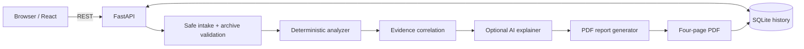
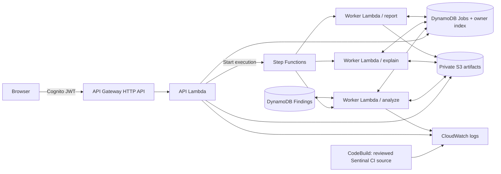

# Architecture

## Local development mode

The default mode runs on a developer workstation: Vite serves the UI; FastAPI performs bounded file inspection; SQLite stores job data; ReportLab generates the fixed four-page report with vector drawing and an optional bundled DejaVu Sans font. There are no AWS calls, external AI calls, dependency installations, or source-code execution in the default analysis path. GitHub input is fetched only from allowlisted public GitHub API/codeload hosts after the URL passes validation.

## AWS deployment target

The SAM template configures these services but has **not** been deployed from this session. AWS usage may incur charges beyond free allowances. The template defaults to `AiProvider=disabled` and the optional CloudWatch alarm disabled. The template is scoped to one region, with `ap-south-1` used in the provided `.env.example`; the deploy region is selectable through SAM.

## Service boundaries

| Component | Input | Output | Privilege boundary |
|---|---|---|---|
| API Lambda | authenticated JSON/ZIP | job state, status URL | own job/table writes, private S3 object I/O, start workflow |
| Worker Lambda | `job_id` and fixed stage name | updated metadata, analysis snapshot, report object | access only to Sentinal tables and bucket; optional narrow model policy |
| Step Functions | job ID | ordered stages | invokes only the worker Lambda |
| S3 | normalized archive, structured analysis, PDF | private objects | block public access; SSE-S3; lifecycle deletes transient/results |
| DynamoDB jobs | job metadata + owner_id + created_at | user-scoped history | query via owner index; point reads for jobs |
| DynamoDB findings | finding ID/status/evidence | triage state | table scoped to app role |
| Cognito | browser sign-in | JWT tokens | API Gateway validates audience and issuer |
| CodeBuild | reviewed Sentinal source ZIP | test/build result logs | small build instance; no privileged Docker; narrow S3 read and log writes |
| CloudWatch | Lambda/CodeBuild logs and default metrics | debugging signal | 7-day Lambda log retention; optional alarm not enabled by default |

## Important choices

- **No untrusted runtime execution by default.** A CodeBuild CI project exists for the platform's own reviewed source. Automatically executing a repository's build/test scripts is deferred until explicit opt-in, isolated networking, data egress limits and role restrictions are designed and tested.
- **No invented measurements.** LOC, language counts, dependency manifests, findings and chart values are derived from the same normalized analysis snapshot.
- **No Bedrock dependency for core use.** A deterministic narrative is produced when AI is disabled or unavailable. Bedrock is a bounded explanatory layer only, not the authoritative source of metrics or findings.
- **No automatic repository changes.** The platform records accepted/fixed/ignored statuses but does not push commits or open pull requests.
- **Multi-user data separation.** The cloud jobs table has an `OwnerCreatedIndex`; job retrieval checks the Cognito `sub` claim before returning data. Local mode has one local user per SQLite database.
