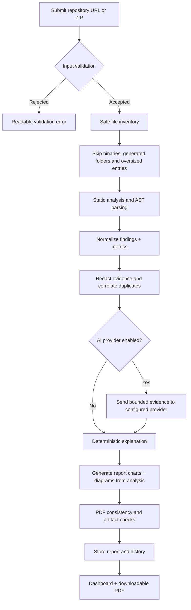

# Data flow

1. **Validate.** GitHub URLs must be HTTPS on GitHub's exact host and follow an accepted path. ZIP submissions must use the ZIP extension, remain under the configured upload cap, and contain safe paths and supported text/source types.
2. **Inventory.** Path normalization and exclusion rules remove binary content, generated directories and oversized entries. The local ZIP is rebuilt using accepted members before analysis. A project snapshot is not executed.
3. **Analyze.** Python files are parsed with the AST module. JavaScript/TypeScript checks focus on selected risky patterns and import strings. Manifests, tests, README presence, TODO/FIXME markers, large files, language counts, source lines and static import relationships are inventoried.
4. **Correlate.** Findings carry rule IDs, severity, confidence, path/line, sanitized evidence, remediation and a verification label. Pattern results can be false positives; the summary describes coverage limitations.
5. **Explain.** By default, explanatory language is produced deterministically. When expressly enabled, an LLM receives a bounded, sanitized evidence subset and must return a structured JSON object. Its narrative is not allowed to override measured counts or source locations.
6. **Report.** An explicitly composed four-page A4 PDF is generated from the stored analysis object: repository tree and summary, severity pie/bar charts, prioritized solutions, and an engineering-intelligence brief. The report includes findings and scope limitations.
7. **Retain/delete.** Local mode retains metadata/results in SQLite; consumed upload archives are removed after reading. AWS mode stores structured results and reports in private S3 and metadata/findings in DynamoDB; lifecycle rules expire temporary input after one day and reports/results after thirty days. Verify actual deployed policies before submitting sensitive source.
